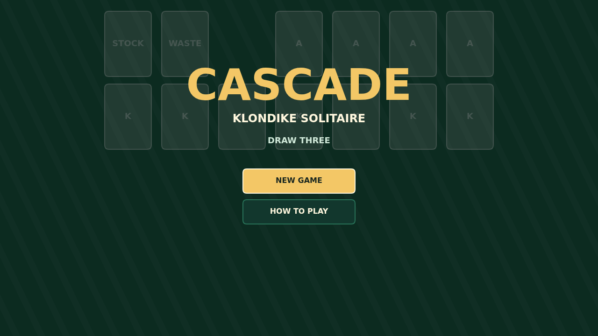
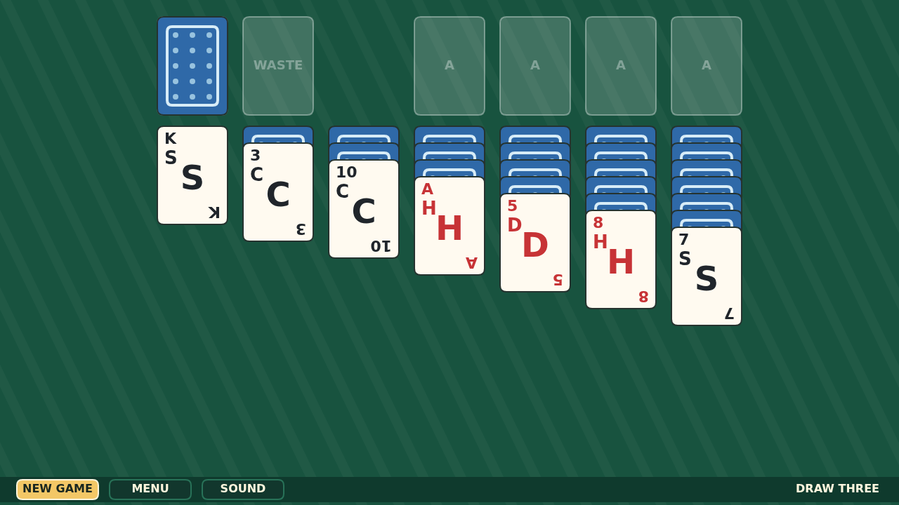

# Cascade

Cascade is a clean, tactile Klondike solitaire played on a green felt table. The
goal is classic: build the four foundations from Ace to King while arranging the
tableau downward in alternating colors.

The stock plays Draw Three, so each turn fans a small set onto the waste and only
the front card is available. Runs lift together under the pointer, empty columns
wait for Kings, and a double-click sends a ready card home.

The ending is the flourish. When the last card reaches the foundations, the
table breaks into a victory cascade: cards launch, bounce, drift, and bury the
felt under their painted trail.

